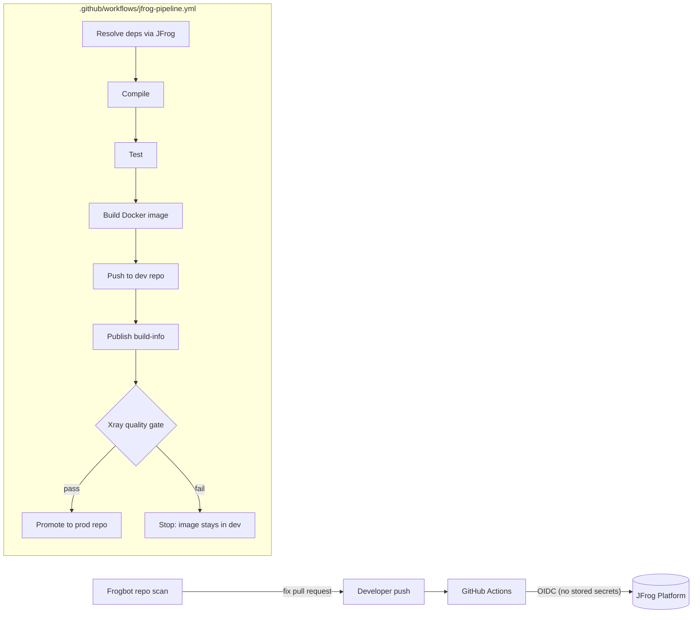

# Secure Software Supply Chain for OWASP Juice Shop with the JFrog Platform

> JFrog Solutions Engineering home assignment.
> This fork of [OWASP Juice Shop](https://github.com/juice-shop/juice-shop) shows a **DevSecOps CI pipeline** built with **GitHub Actions** and the **JFrog Platform** (Artifactory, Xray, Frogbot).
> The original Juice Shop README is available upstream: <https://github.com/juice-shop/juice-shop#readme>

---

## 1. What this pipeline does



| Step | How | Why |
|---|---|---|
| Authenticate | `jfrog/setup-jfrog-cli` with **OIDC** (`github-oidc` integration, restricted to org `antjeba` + repo `antjeba/juice-shop`) | No long-lived credentials in CI |
| Resolve dependencies | `npm` and `jf npm install` against `juice-npm-virtual` only | Nothing is downloaded directly from the internet. Every package is cached, indexed and scanned by Xray |
| Block install scripts | `--ignore-scripts`, then `npm rebuild sqlite3` for the one native module | Protects against malicious `postinstall` scripts in the supply chain |
| a) Compile | `npm run build` (Angular frontend + TypeScript server) | |
| b) Test | `npm run test:server` (≈390 existing unit tests) | |
| c) Package | `Dockerfile.jfrog`: distroless, non-root, base image pulled via `juice-docker-virtual` | Docker only packages the tested build output, no network access during `docker build` |
| Traceability | `jf rt build-collect-env`, `build-add-git`, `build-publish` | Build-info links commit, dependencies, environment and image |
| Quality gate | `jf build-scan` against Xray policy `block-critical-vulns` (watch `juice-shop-watch`) | Pipeline fails on **Critical** CVEs |
| Promotion | `jf rt build-promote … juice-docker-prod-local` | Only images that passed the gate reach the prod repository |
| Deliverable | `docker save` artifact uploaded to the run | Runnable image download |

## 2. Repository management

Naming convention `<project>-<technology>-<maturity>-<locator>`, created as code with [`jfrog/create-repos.sh`](jfrog/create-repos.sh) (workflow *Setup JFrog Repositories*).

| Repository | Type | Purpose |
|---|---|---|
| `juice-npm-remote` | Remote → registry.npmjs.org | Proxy/cache for npm |
| `juice-npm-dev-local` | Local | Internal npm packages |
| `juice-npm-virtual` | Virtual | **Single entry point** for npm in CI |
| `juice-docker-hub-remote` | Remote → Docker Hub | Proxy/cache for base images |
| `juice-docker-gcr-remote` | Remote → gcr.io | Proxy/cache for distroless base image |
| `juice-docker-dev-local` | Local | Images built by CI (not yet released) |
| `juice-docker-prod-local` | Local | Images that passed the quality gate |
| `juice-docker-virtual` | Virtual | **Single entry point** for Docker |

All repositories are indexed by Xray.

## 3. Xray results (image `juice-shop:2`)

**92 vulnerabilities:** 6 Critical, 21 High, 45 Medium, 15 Low, 5 Unknown, across 558 components (540 npm, 14 Debian).

### Most risky finding: CVE-2015-9235 in `jsonwebtoken 0.1.0` (via `express-jwt 0.1.3`)

- **Severity:** Critical, CVSS 9.8 (highest in the scan).
- **What it is:** JWT signature verification can be bypassed (algorithm confusion). An attacker can forge their own valid token.
- **Why it is the most risky:**
  1. **It is reachable.** `express-jwt` guards 27 API routes in `server.ts` and is configured without a fixed algorithm (`lib/insecurity.ts`, line 52).
  2. **High impact:** authentication bypass, so any account can be taken over, including admin.
  3. **Easy to exploit:** remotely, without authentication or user interaction. Public since 2015.
  4. **A fix is available.** In contrast, the Debian `libc6` findings have no fix yet and are harder to exploit.
- **Remediation:**
  1. Upgrade `express-jwt` to a current version (≥ 6.0.0) and `jsonwebtoken` to ≥ 9.0.0.
  2. Pin the algorithm when verifying: `algorithms: ['RS256']`.
  3. Re-run the pipeline. The Xray gate verifies the fix.
  One upgrade removes **6 findings** (2 Critical, 4 High), because `jsonwebtoken` and an old `moment` come in transitively through `express-jwt`.

> Juice Shop is *intentionally* vulnerable, so the gate is expected to fail. This shows that an insecure image never reaches `prod`.

### Exports
- Xray scan data (JSON): attached to the submission email
- SBOM (CycloneDX 1.7, JSON): attached to the submission email

## 4. Frogbot vs. Docker image scan

Frogbot (`.github/workflows/frogbot-scan-repository.yml`) scans the **source repository** and opened [pull request #1](https://github.com/antjeba/juice-shop/pull/1) with fixes for 5 direct dependencies.

| | Frogbot (source / SCA) | Xray (Docker image) |
|---|---|---|
| **Findings** | **107** (GitHub → Security → Code scanning) | **92** |
| **What is scanned** | `package.json` in Git (root and `frontend/`) | The final, shipped image |
| **When** | Early: on the repo / pull request ("shift left") | After build, before promotion |
| **Build/dev tooling** | ✅ Included, e.g. `vite 8.3.5` (Critical, via the Angular build) and `@cyclonedx/cyclonedx-npm` (High) | ❌ Not in the image, so not reported |
| **OS packages from base image** | ❌ Not visible | ✅ 14 Debian packages, e.g. `libc6` (24 issues) |
| **View** | Direct dependencies a developer can change | Every physical component, including transitive ones |
| **Output** | Fix pull request and GitHub code scanning | Policy violations, quality gate, SBOM |

**Takeaway:** both are needed. Frogbot gives developers fast, actionable fixes in their workflow. The image scan is the source of truth for what actually runs in production.

## 5. How to run

**From the pipeline artifact** (Actions → run → *juice-shop-docker-image*):
```bash
docker load -i juice-shop-image.tar.gz
docker run --rm -p 3000:3000 trialshcdre.jfrog.io/juice-docker-dev-local/juice-shop:2
# open http://localhost:3000
```

**From JFrog:**
```bash
docker login trialshcdre.jfrog.io
docker run --rm -p 3000:3000 trialshcdre.jfrog.io/juice-docker-virtual/juice-shop:2
```

**On Kubernetes:** see [`deploy/k8s/juice-shop.yaml`](deploy/k8s/juice-shop.yaml).

Replace `2` with the build number of the run you want.

## 6. Files added in this fork

| File | Purpose |
|---|---|
| `.github/workflows/jfrog-pipeline.yml` | Main CI pipeline |
| `.github/workflows/setup-jfrog.yml` + `jfrog/create-repos.sh` | Repository setup as code |
| `.github/workflows/frogbot-scan-repository.yml` | Frogbot SCA scan |
| `Dockerfile.jfrog` + `Dockerfile.jfrog.dockerignore` | Runtime image (distroless, non-root) |
| `deploy/k8s/juice-shop.yaml` | Kubernetes deployment |

## 7. Known limitations and next steps

- `sqlite3` downloads a prebuilt native binary from GitHub during `npm rebuild`. In production this would be proxied through a JFrog **Generic remote** repository.
- **Contextual Analysis** (JFrog Advanced Security) was not active in this trial. It would automatically confirm reachability, which I verified by hand for the top finding.
- Next steps: **JFrog Curation** to block malicious packages before download, signed **Release Bundles** with **Evidence** for promotion, and a Frogbot pull request scan on every PR.
